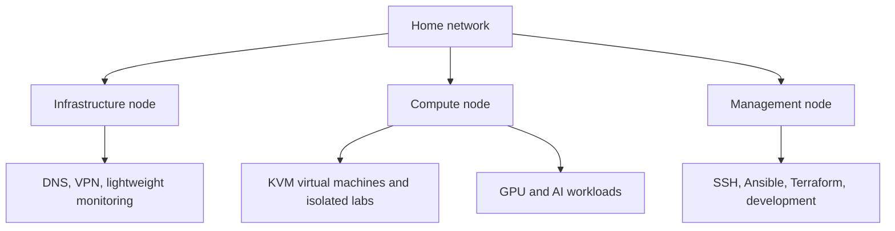

# Homelab Infrastructure

A personal, self-hosted environment for exploring modern infrastructure, automation, networking, security and emerging technologies.

## Overview

This repository documents the design, implementation and continuous evolution of my personal homelab. The project provides a practical environment for experimenting with technologies, developing applications and hosting services using open-source tools, infrastructure as code and reproducible configurations.

**Status:** Planning and foundation setup. Services described below are proposed, not deployed.

## Objectives

- Build reusable infrastructure independent of individual projects.
- Automate provisioning and configuration using infrastructure as code.
- Experiment with isolated environments and self-hosted applications.
- Document implementation, verification, troubleshooting and architectural decisions.
- Reuse existing hardware before purchasing additional equipment.

## Hardware

| Node | CPU | RAM | Storage | Role |
|---|---|---|---|---|
| compute-01 | Ryzen 9 9950X | 64 GB | Separate OS SSDs | Compute and virtualization |
| infra-01 | Intel Core 3 100U | 8 GB | 512 GB SSD | Always-on infrastructure |
| admin-01 | Intel Core i7, 6 cores | 16 GB | 512 GB SSD | Administration and development |

The compute node has an NVIDIA RTX 5060 Ti with 16 GB VRAM and dual-boots Windows 11 Pro and Ubuntu. The infrastructure node infrastructure node currently runs Windows 11 Home; Ubuntu Server installation is planned. The administration node runs macOS.

## Proposed architecture

Core infrastructure is intended to remain available when the compute node is offline or running Windows. Compute-node-hosted services will not be available during those periods. Network segmentation and storage design remain open decisions.

## Roadmap

- [ ] Foundation: Ubuntu Server, networking, SSH and host security
- [ ] Virtualization and private cloud experiments
- [ ] Infrastructure automation
- [ ] Network segmentation and security
- [ ] Kubernetes and container orchestration
- [ ] Enterprise DevSecOps and artifact delivery
- [ ] Local AI and GPU computing
- [ ] Application development and hosting
- [ ] Isolated cybersecurity labs
- [ ] Smart home and personal services
- [ ] Observability and centralized logging
- [ ] Backups, recovery and availability experiments

## Documentation

- [Architecture](docs/architecture/overview.md)
- [Hardware inventory](docs/hardware/inventory.md)
- [Architecture decision: infrastructure OS](docs/decisions/0001-infrastructure-os.md)
- [Foundation installation plan](docs/installation/ubuntu-server.md)
- [Changelog](CHANGELOG.md)

## Security and privacy

Do not commit credentials, private keys, tokens, real network addresses, hardware serial numbers, personal information. Use synthetic examples and isolated test environments. Do not expose management interfaces directly to the internet.

## License

Released under the [MIT License](LICENSE).
